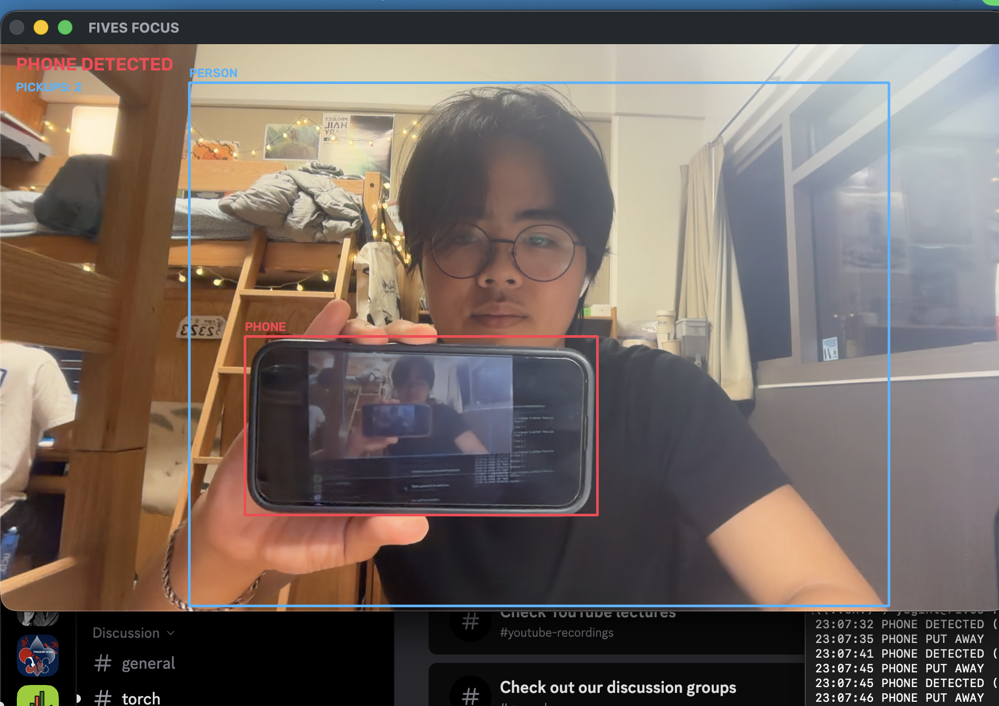

# FIVES Focus Tracker 

A webcam focus tracker that notices when you pick up your phone during a study session.

If a phone appears in frame, a red box appears, the status switches from FOCUSED to PHONE DETECTED, and the pickup counter goes up by 1. Every pickup is logged with the time.

## Demo

terminal log: 

Video: (https://drive.google.com/file/d/1IrrZGsyGfRFgbjjuhSdOJfg7gTawNXkB/view?usp=drive_link)

## Inspo

I want to add this to my bigger personal project, FIVES, an all-in-one workflow interface and study tool. It's another way to optimize studying: my computer gets mad at me when I'm not focused.

## Model and why

I used YOLO11n (Ultralytics) because it's a pretrained model that works out of the box. It already knows how to detect a person and a cell phone (COCO classes 0 and 67), and because it's the nano version, it's fast enough to run live on a MacBook webcam.

## How it works

`focus.py` runs one loop, about 30 times per second:

1. Read a frame from the webcam (stop cleanly if the camera fails).
2. 3. Run YOLO11n on the frame, only looking for people and phones, and ignoring detections under 50% confidence.
3. For each detection, draw a box: blue for a person, red for a phone. Note whether any phone was found.
4. Smooth out flicker: the phone only counts as gone after it has been missing for 15 frames in a row.
5. Compare with the previous frame. If a phone just appeared, add a pickup and log the time. If it just went away, log that too.
6. Draw the status (FOCUSED / PHONE DETECTED) and the pickup count, then show the frame.

`detect.py` was my first test to learn how the model works: it runs the same model on a single image and prints what it finds.

## Custom behavior
This project's behavior is a phone-specific alert, so the study session is only interrupted when a cellphone is detected. There's also an event log in the terminal that records when I pick up my phone and when I put it down.

In my first tests, the alert and pickup counter went up multiple times while the phone was in frame, because the detector would miss the phone for a split second. I fixed it so the phone only counts as put away after it hasn't been detected for more than 15 frames, so each real pickup is counted once.

## No detections

With nothing detected, the loop over boxes simply runs zero times, the status stays FOCUSED, and the program keeps running. If the camera stops giving frames, the program exits cleanly instead of crashing.

## Install and run

Requires Python 3.12 and a webcam (tested on macOS).

## Limitations and improvements

- If you use your phone out of the camera's view (under the desk, for example), nothing happens.
- Detection depends on lighting and angle. A phone held flat or face-down is harder to detect.
- Improvement: flag me if I look away from my screen for an extended period (around 10 seconds), since that means I'm focused on something else.
- Improvement: save the event log to a file and show session stats.

## AI assistance

I set up the project and wrote `detect.py` (the detection loop and class name lookup), the webcam loop, the mirror flip, the phone check, and the FOCUSED / PHONE DETECTED status logic. 

I asked claude for help with the custom colored box drawing, and for the start of the 15-frame flicker fix, I reviewed all of it and can explain every line.
claude also helped with writing the readme because time :P
